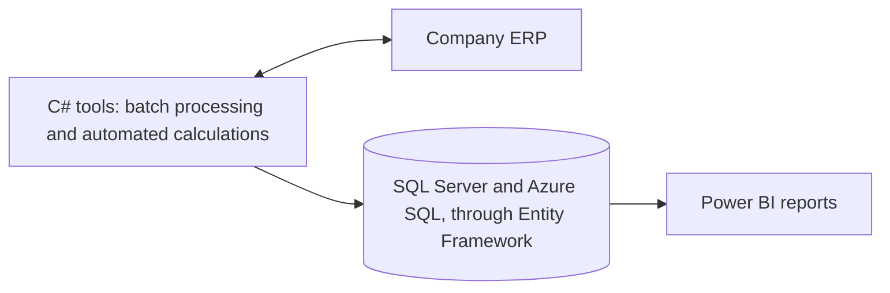

# ASEGURE payroll automation: case study

> **Private code.** The source code belongs to the client and is not published. This repository is a case study: it describes the project at a high level, with no code, no screenshots and no internal details.

| | |
| --- | --- |
| **Client** | ASEGURE |
| **Year** | 2023 |
| **Status** | In production |

## Context

ASEGURE's payroll generation involved complex calculations and had to integrate with the accounting systems the company already used.

## My role

Developer of the payroll tools: batch processing, the calculations, the SQL behind them and the integration with the ERP.

## Architecture

- C# tools process payroll in batches and run the calculations automatically.
- Optimized SQL queries do the heavy work on SQL Server and Azure SQL.
- The tools are integrated with the ERP, and their output feeds the Power BI reports.

## Key features

- Batch processing
- Automated calculations
- ERP integration
- BI reports

## Stack

C# · SQL Server · Entity Framework · Azure SQL · Power BI

## Results

In production: the tools automate payroll generation and feed the BI reports.
